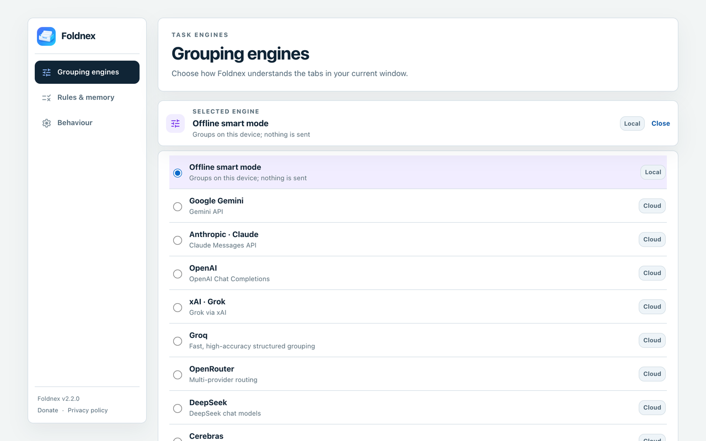
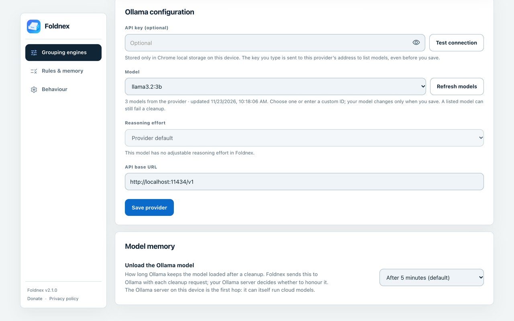
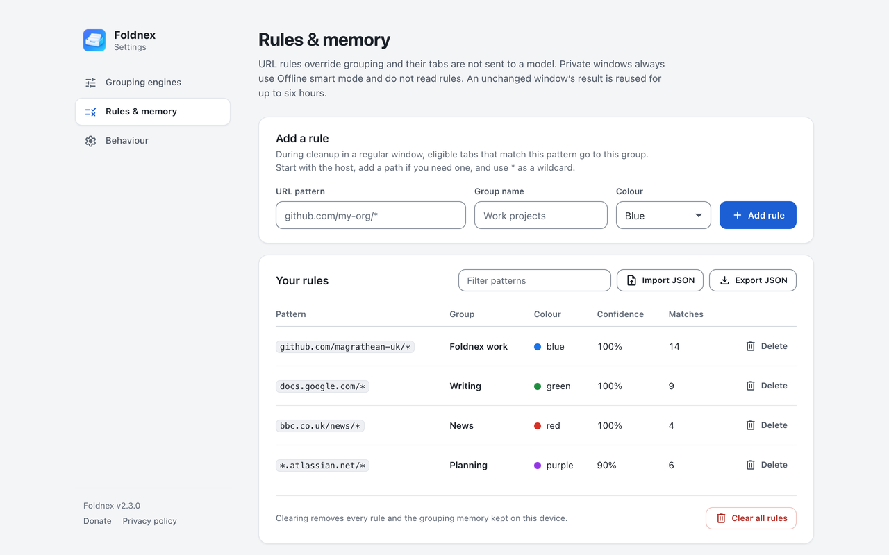
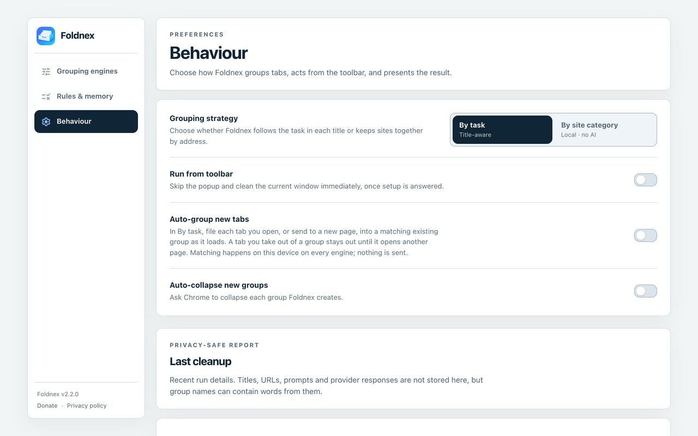
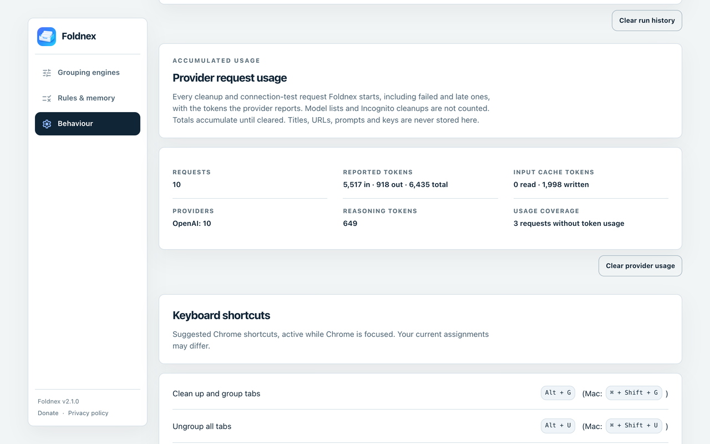

# Using Foldnex

Foldnex removes conservative duplicate pages and organises the remaining tabs in the current Chrome window into tab groups. Cleanup closes redundant tabs. **Ungroup current window** removes groups where Chrome allows, but does not restore closed tabs or the original tab order.

## Start

1. Open Foldnex from Chrome's toolbar.
2. In the setup card choose **Offline smart mode** to group on this computer, or **Cloud AI** to use a provider with your own API key.
3. Select **Clean up and group**.
4. Use **Rules and settings** to change engines, add rules or inspect the cleanup report.

A new install starts on Offline smart mode with **By task**. The setup card stays until you answer it, but never blocks a cleanup.

Duplicate cleanup prefers a pinned survivor, then the active tab, then the leftmost copy. It preserves query differences and routes in URL fragments, while ignoring ordinary document anchors. A small allowlist of stateless Chrome pages can also be deduplicated. Pinned and browser-internal tabs stay outside grouping.

## Gemini Nano has moved to Offline smart mode

Foldnex 2.1 no longer uses Chrome's built-in Gemini Nano. If you had chosen it, Foldnex now uses Offline smart mode, which groups on this computer with a word table packaged in Foldnex and needs no model download. Nothing is sent, as before. The background preparation switch and the Nano memory controls are gone because Foldnex no longer prepares anything in the background. Your rules and renamed groups are kept.

## Choose a strategy and engine

| Choice | How tabs are grouped | What is sent |
| --- | --- | --- |
| By site category | Local address-based categories and service names | Nothing |
| By task: Offline smart mode | The local engine groups by tab titles and address words, with a word table built into Foldnex | Nothing |
| By task: Ollama | At most one request per cleanup to your Ollama server | Titles and short site hints, to your Ollama server; at a loopback address that server is the first hop and can itself run cloud models |
| By task: cloud engine | At most one request per cleanup; the model returns groups and names | Titles and short site hints, to the provider you chose, when you clean up |

Cloud engines are Google Gemini, Anthropic · Claude, OpenAI, xAI, Groq, OpenRouter, DeepSeek and Cerebras. Cloud engines always use their provider's own address; a saved address override is ignored. Ollama defaults to `http://localhost:11434`. An Ollama address must use HTTPS unless it is on this device, and must not contain credentials (any `@`), a query or a fragment; otherwise it is not used and cleanups run locally. Provider requests do not follow redirects. A saved Ollama address does not grant additional Chrome host permissions.

Private (Incognito) windows send nothing, whatever engine is selected: By task uses Offline smart mode and By site category stays local.

**Anthropic needs Chrome's permission first.** Foldnex can reach `api.anthropic.com` only after you allow it: Chrome asks when you choose or save Anthropic, or run its Test connection, in Settings, in the popup's engine list or in the setup card. If you decline, or have not been asked yet, the popup shows **Access needed** and a cleanup with Anthropic groups on this computer, sends nothing and says that access must be allowed in Settings. Choosing another engine does not withdraw the permission; remove it at `chrome://extensions` → Foldnex → Details if you want to. Anthropic's default model is `claude-opus-5-5` at low effort.

**How a cloud cleanup works.** Foldnex sends at most one request for the window: each eligible tab's title (up to 160 characters) and a short host/path hint. For web addresses the hint has no query string, fragment or credentials, and long identifiers in the path are replaced with `:id`, but titles and paths can still contain private text. Pinned and browser-internal tabs are not sent; some other tabs, such as local files, can be. Tabs matched by your URL rules and social sites stay in their own groups and are not sent. The model returns named groups; Foldnex checks and repairs the answer (each tab placed at most once, names validated) and applies it. Tabs the model leaves out go to **Review Later**. If no usable task group remains, Foldnex groups locally instead.

- No request is sent when the window has fewer than two eligible tabs or no free group slot.
- After a plan has been applied, a second click on a window that has not changed sends nothing and gives the same groups. A failed or discarded request can be sent again on the next click.
- If at most 10% of the window's eligible tabs are new or changed since the model's last plan, Foldnex keeps the groups and adds the new tabs on this computer, with no request. Tabs it cannot match wait in Review Later, and some may stay ungrouped. Past 10%, the next cleanup asks for a new plan.
- Foldnex waits about 5.4 seconds for the answer. If it is later, the local grouping is applied straight away, and an answer that arrives within 30 seconds and still matches the window is offered in the popup. It is applied only when you select **Apply**. Cancelling or ignoring it does not retract what the provider already received.
- If the request fails, the local grouping is applied and the popup says why. The request has still been sent.

On twelve synthetic evaluation windows (906 tabs, pairwise F1 over all tabs against hand-made task groups), Foldnex's Anthropic engine with its default model (Claude Opus 5.5, low effort) scored 0.88, a Claude Sonnet 5.5 plan measured directly against the Claude API 0.84 and OpenAI's default model 0.74 to 0.77, against 0.42 for 2.0-style per-tab labels. Offline smart mode scored 0.39, against 0.19 for 2.0's local rules. Other engines' default models were not measured, and results on your windows will differ.

In By task mode Foldnex's own result uses at most ten groups, counting rule, Socials and Review Later groups. Rule and Socials groups are always kept, so many matching rules can exceed ten, and groups already in the window can remain. When the slots run out, some tabs stay ungrouped. By site category has no ten-group ceiling.

Renaming a tab group in a regular window, including one you created yourself, teaches Foldnex your name for those tabs: it saves the name, colour and fingerprints of the tabs on this computer. Your own names are kept as typed (up to 30 characters in name memory); model names are checked locally.

## Configure a cloud provider

1. Open **Rules and settings → Grouping engines** and select a provider.
2. Enter its API key or supported bearer token. For Anthropic, allow access to `api.anthropic.com` when Chrome asks.
3. Choose from the live model catalog, or use **Custom model** to enter an ID.
4. Save the provider.
5. Use **Test connection** beside the key: it sends one grouping request for two made-up tabs, never your window.

Settings loads the provider's model list when it opens on that provider, when you finish editing the key, token or address, after Save and after a successful test; **Refresh models** asks again. These requests, and the test, use the key currently typed, even before you save, and send no tab data. Settings opens in a regular window, even from a private window's popup, so its model lists and Test connection are regular-window requests. A listed model or a passed test does not prove every cleanup will succeed. Tests and cleanups can incur provider charges.

Cleanups and tests request the lowest reasoning effort Foldnex offers for the model, or send no reasoning setting where Foldnex has none; the reasoning control in Settings does not change that. OpenAI's default model is `gpt-6-luna`. **Priority processing** is on by default and requests the priority service tier, which can cost more; turn it off to request the default tier. Availability, the tier returned and billing are under the provider's control.

API credentials are stored locally in trusted extension storage until you replace them: clear the field and save. For OpenAI clear both the API key and the bearer token. Other settings, including model IDs and an Ollama address, may sync through Chrome. Rule export does not include credentials.

## Ollama on this device

Loopback Ollama is the first hop: the request goes to the Ollama server on this device, and that server can itself run cloud models. To keep tab data on this computer, use local models only or turn off Ollama's cloud features.

For Ollama at a local address, **Model memory → Unload the Ollama model** tells your Ollama server how long to keep its model loaded after a request: right after use, 2, 5 (default), 15 or 60 minutes, or keep loaded. Foldnex sends it with each cleanup as Ollama's `keep_alive`; whether it is honoured depends on your Ollama server.

## Auto-group new tabs

With **Auto-group new tabs** on (Behaviour, By task, any engine), a tab you open or send to a new page joins the existing group in its window that matches its title best. A tab with no good match stays ungrouped. Matching happens on this computer; nothing is sent, and no new group is created. A tab you take out of a group stays out until it opens another page. Tabs opened in the first 20 seconds after Chrome starts, tabs restored without loading, and incognito tabs are left alone. To recognise new pages and tabs taken out of a group, Foldnex keeps tab IDs and address hashes in session storage, even while Auto-group is off.

## Rules and memory

In **Rules & memory**, add a URL pattern, group name and colour. A pattern is a hostname followed by an optional path, such as `example.org/projects/*`; the wildcard applies within that host, so `*` in the hostname does not widen it to other sites. Patterns are case-insensitive, use `*` as the only wildcard, and allow up to 200 characters. Other punctuation is literal. Rules come first and their tabs are not sent to a model. Private (Incognito) windows send nothing, whatever engine is selected: By task uses Offline smart mode and By site category stays local.

Use **Import JSON** and **Export JSON** to transfer rules. Imports require a JSON array, validate each rule, and accept files up to 1 MB. Import stops once the merged list reaches 300 rules; invalid entries are skipped, and a malformed file can fail without changing your saved rules. An export is a browser download whose patterns and names can contain private information; delete it separately.

Foldnex remembers your group renames for 90 days (up to 120 names) and keeps separate rename preferences for exact sets of tabs (up to 100, no age limit). An unchanged window's result is reused for six hours. These records match tabs by hashes, not raw titles or addresses, but saved group names can reveal their subject.

| Control | What it resets |
| --- | --- |
| Clear all rules | Rules, exact results, name memory and rename preferences; stored window plans and offers stop being reused |
| Clear run history | Cleanup diagnostics (a cleanup still running can add a record afterwards) |
| Clear provider usage | Request and reported-token totals |

Clearing rules does not clear credentials, engine preferences, cleanup history or usage totals.

## Behaviour, shortcuts and reports

In **Behaviour**, **Run from toolbar** runs cleanup directly when you click Foldnex. Until the setup card is answered, the toolbar still opens the popup. **Auto-collapse new groups** asks Chrome to collapse each group Foldnex creates.

| Action | Windows/Linux | macOS |
| --- | --- | --- |
| Clean up and group | Alt+G | Command+Shift+G |
| Ungroup current window | Alt+U | Command+Shift+U |

These are suggested shortcuts and work while Chrome is focused. Check or change the current assignments at `chrome://extensions/shortcuts`.

**Last cleanup** reports the engine, source (for example cloud plan, plan upkeep, exact cache or offline fallback), requests, tokens, latency, quality and any fallback. **Provider request usage** counts every cleanup and test request Foldnex starts, including failed and late ones. Model lists and incognito cleanups do not count. It stores counts and reported tokens, not tab content, prompts, responses or credentials, and is not a bill.

Screenshots 01, 02, 03 and 05 are automated captures of the 2.1.0 extension; the usage figures in 02 are seeded examples, and 05 shows a model list from a local stand-in. Screenshot 04 is a retained 2.0.0 capture of the Rules & memory controls. Provenance is recorded in [the store asset manifest](../store-assets/manifest.json).

## Incognito

Private (Incognito) windows send nothing, whatever engine is selected: By task uses Offline smart mode and By site category stays local. A cleanup in an incognito window stays inside that window and saves no results, names, plans, diagnostics or usage from it, and it does not read your saved rules. The popup can show regular-window statistics. Auto-group never touches incognito tabs.

## Troubleshooting

- **Cloud fallback:** check the provider, key and model; use **Test connection** before sending a real window.
- **The popup offers a late grouping:** the model answered after the cleanup. Select **Apply** to use it, or ignore it. If you changed the window meanwhile, run a cleanup again.
- **Nothing was sent after new tabs:** at most 10% of the tabs were new or changed since the last model plan, so Foldnex added them locally. Add more tabs, or clear rules to start fresh, to get a new plan.
- **Tab remains outside a group:** pinned and internal tabs are excluded; when the group slots are used up or Chrome refuses a placement, some tabs stay ungrouped; Auto-group leaves a tab alone when no group matches.
- **Change not visible in an unpacked install:** reload Foldnex at `chrome://extensions`, then reopen its popup or Settings.

For a reproducible bug, follow [Support](../.github/SUPPORT.md) and use synthetic tab examples. See [Privacy](legal/privacy.md) for full data handling, [Terms](legal/terms.md) for product terms and the [product contract](architecture/product.md) for implementation details.
